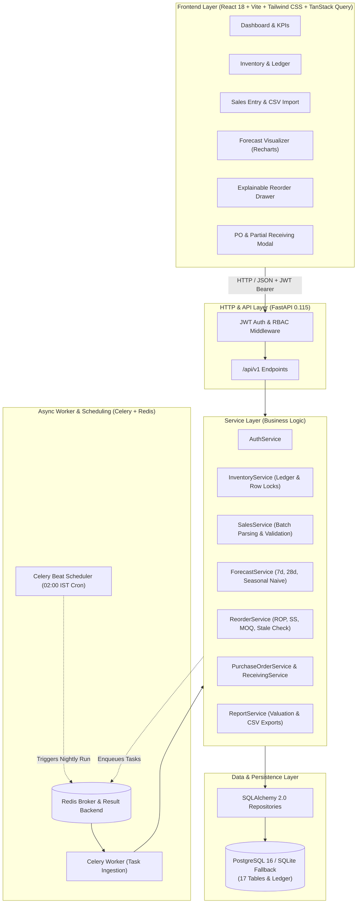

# StockSense — System Architecture & Workflow Specifications

This document outlines the high-level architecture, business lifecycle workflows, and database entity relationships for **StockSense — Predictive Inventory Reorder Engine**.

---

## 1. System Architecture Diagram

StockSense is built as a **modular monolith** adhering to the Clean Architecture pattern:
- **API Routers**: Validate incoming requests, authenticate JWT bearer tokens, and enforce Role-Based Access Control (`ADMIN`, `MANAGER`, `STAFF`).
- **Domain Services**: Encapsulate all inventory rules, demand forecasting algorithms, order approval workflows, and over-receipt validations.
- **Data Repositories**: Abstract database queries using SQLAlchemy 2.0 ORM with row-level locks (`with_for_update`) on stock-altering operations.
- **Asynchronous Task Queue**: Celery with Redis broker handles scheduled nightly forecast generation and atomic CSV ingestion without blocking HTTP request threads.
- **Storage Layer**: Dual support for PostgreSQL (production / Docker Compose) and SQLite with WAL mode & foreign keys enabled (local developer fallback).



---

## 2. Business Workflow Diagram

The retail replenishment lifecycle ensures that sales are accurately audited, forecasts are validated against real holdout performance, reorder recommendations are mathematically explainable, and deliveries update physical stock atomically.

```mermaid
sequenceDiagram
    autonumber
    actor Staff as Store Staff
    actor Manager as Inventory Manager
    participant UI as StockSense UI
    participant API as FastAPI Backend
    participant Ledger as Stock Movements & Balances
    participant Engine as Forecast & Reorder Engine
    participant PO as Purchase Order Workflow

    rect rgb(240, 249, 255)
    note over Staff, Ledger: Phase A: Sales Ingestion & Inventory Depletion
    Staff->>UI: Record Sale or Upload Multi-line CSV
    UI->>API: POST /api/v1/sales (or /sales/import-csv)
    API->>Ledger: Atomic Deduction: on_hand_qty - Qty
    Ledger-->>API: Write stock_movement (type: SALE)
    API-->>UI: Sale Confirmed & Balances Updated
    end

    rect rgb(245, 255, 245)
    note over Manager, Engine: Phase B: Demand Forecasting & Replenishment Calculation
    Manager->>UI: Trigger Nightly / Manual Forecast Run
    UI->>API: POST /api/v1/forecasts/run
    API->>Engine: Run 3 Baselines (7d, 28d, Seasonal Naive)
    Engine->>Engine: Holdout MAE Evaluation & Censor Stockouts
    Engine->>Engine: Calculate IP, LTD, SS, ROP, Target Stock
    Engine->>Engine: Round to Supplier MOQ & Pack Size
    Engine-->>API: Persist Active Reorder Recommendations
    API-->>UI: Recommendations Ready with Detailed Math
    end

    rect rgb(255, 250, 240)
    note over Manager, PO: Phase C: Order Approval, Placement & Receiving
    Manager->>UI: Review Calculation Breakdown in Drawer
    Manager->>UI: Approve Recommendation (adjust qty / date)
    UI->>API: POST /api/v1/recommendations/{id}/approve
    API->>API: Verify Inventory Position Drift (<= 5 units)
    API->>PO: Generate Purchase Order (Status: DRAFT)
    Manager->>UI: Place Order with Vendor
    UI->>API: POST /api/v1/purchase-orders/{id}/place
    API->>PO: Status -> PLACED (Eligible Open Inbound increases)
    
    Vendor Delivery Arrives
    Manager->>UI: Open Partial Receiving Form
    UI->>API: POST /api/v1/receiving/receive
    API->>PO: Validate received_qty <= remaining_qty
    API->>Ledger: Increment on_hand_qty & Log PURCHASE_RECEIPT movement
    API->>PO: Update remaining_qty -> PARTIALLY_RECEIVED or RECEIVED
    API-->>UI: Goods Receipt Generated & Inventory Updated
    end
```

---

## 3. Database Entity-Relationship Diagram

StockSense uses an immutable audit ledger pattern for all stock modifications. Product balances are updated atomically within the same database transaction as the corresponding movement.

```mermaid
erDiagram
    USERS ||--o{ AUDIT_LOGS : performs
    USERS ||--o{ STOCK_MOVEMENTS : creates
    USERS ||--o{ SALES : records
    USERS ||--o{ PURCHASE_ORDERS : places

    CATEGORIES ||--o{ PRODUCTS : categorizes
    SUPPLIERS ||--o{ PRODUCT_SUPPLIERS : offers
    PRODUCTS ||--o{ PRODUCT_SUPPLIERS : supplied_by

    WAREHOUSES ||--o{ INVENTORY_BALANCES : stores
    PRODUCTS ||--o{ INVENTORY_BALANCES : holds

    WAREHOUSES ||--o{ STOCK_MOVEMENTS : locates
    PRODUCTS ||--o{ STOCK_MOVEMENTS : tracks

    SALES ||--|{ SALE_ITEMS : contains
    PRODUCTS ||--o{ SALE_ITEMS : sold_in

    FORECAST_RUNS ||--o{ FORECASTS : generates
    PRODUCTS ||--o{ FORECASTS : predicts

    FORECAST_RUNS ||--o{ REORDER_RECOMMENDATIONS : triggers
    PRODUCTS ||--o{ REORDER_RECOMMENDATIONS : recommends_for
    SUPPLIERS ||--o{ REORDER_RECOMMENDATIONS : sourced_from

    SUPPLIERS ||--o{ PURCHASE_ORDERS : fulfills
    WAREHOUSES ||--o{ PURCHASE_ORDERS : delivers_to
    PURCHASE_ORDERS ||--|{ PURCHASE_ORDER_ITEMS : specifies
    PRODUCTS ||--o{ PURCHASE_ORDER_ITEMS : ordered_for

    PURCHASE_ORDERS ||--o{ GOODS_RECEIPTS : receives
    GOODS_RECEIPTS ||--|{ GOODS_RECEIPT_ITEMS : verifies
    PURCHASE_ORDER_ITEMS ||--o{ GOODS_RECEIPT_ITEMS : fulfills_item

    USERS {
        int id PK
        string email UK
        string hashed_password
        string full_name
        string role "ADMIN | MANAGER | STAFF"
        boolean is_active
        datetime created_at
    }

    PRODUCTS {
        int id PK
        string sku UK
        string name
        int category_id FK
        string unit
        decimal selling_price
        int safety_stock
        int min_reorder_qty
        decimal manual_daily_demand
        int lead_time_days
        boolean is_active
    }

    SUPPLIERS {
        int id PK
        string name
        string contact_name
        string email
        string phone
        string address
        int lead_time_days
        boolean is_active
    }

    PRODUCT_SUPPLIERS {
        int id PK
        int product_id FK
        int supplier_id FK
        int lead_time_days
        int minimum_order_qty
        int pack_size
        decimal unit_cost
        boolean is_preferred
    }

    INVENTORY_BALANCES {
        int id PK
        int product_id FK
        int warehouse_id FK
        int on_hand_qty
        int reserved_qty
        datetime updated_at
    }

    STOCK_MOVEMENTS {
        int id PK
        int product_id FK
        int warehouse_id FK
        int quantity_delta
        string movement_type "SALE | PURCHASE_RECEIPT | ADJUSTMENT"
        string reference_type
        string reference_id
        int balance_after
        string reason
        int created_by FK
        datetime created_at
    }

    SALES {
        int id PK
        string external_sale_id
        date sale_date
        decimal total_amount
        string channel
        int created_by FK
    }

    SALE_ITEMS {
        int id PK
        int sale_id FK
        int product_id FK
        int quantity
        decimal unit_price
        decimal subtotal
    }

    FORECAST_RUNS {
        int id PK
        string run_id UK
        string status "COMPLETED | RUNNING | FAILED"
        date data_cutoff
        datetime completed_at
        json summary
    }

    FORECASTS {
        int id PK
        int forecast_run_id FK
        int product_id FK
        date forecast_date
        decimal forecast_qty
        string method
        decimal mae
        decimal wape
    }

    REORDER_RECOMMENDATIONS {
        int id PK
        int product_id FK
        int warehouse_id FK
        int forecast_run_id FK
        int inventory_position_snapshot
        int reorder_point
        int target_stock
        int suggested_qty
        string priority "HIGH | MEDIUM | LOW"
        string status "PENDING | APPROVED | DEFERRED | DISMISSED"
        json calculation_details
        boolean is_active
    }

    PURCHASE_ORDERS {
        int id PK
        string po_number UK
        int supplier_id FK
        int warehouse_id FK
        string status "DRAFT | PLACED | PARTIALLY_RECEIVED | RECEIVED | CANCELLED"
        date expected_delivery_date
        decimal total_amount
    }

    PURCHASE_ORDER_ITEMS {
        int id PK
        int purchase_order_id FK
        int product_id FK
        int quantity_ordered
        int quantity_received
        decimal unit_cost
    }

    GOODS_RECEIPTS {
        int id PK
        string receipt_number UK
        int purchase_order_id FK
        date received_date
        string notes
        int created_by FK
    }

    GOODS_RECEIPT_ITEMS {
        int id PK
        int goods_receipt_id FK
        int po_item_id FK
        int product_id FK
        int quantity_received
        decimal unit_cost
    }
```


